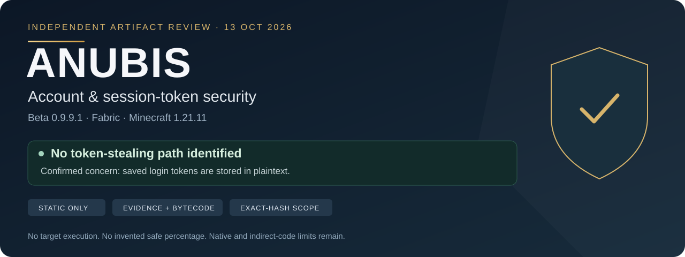
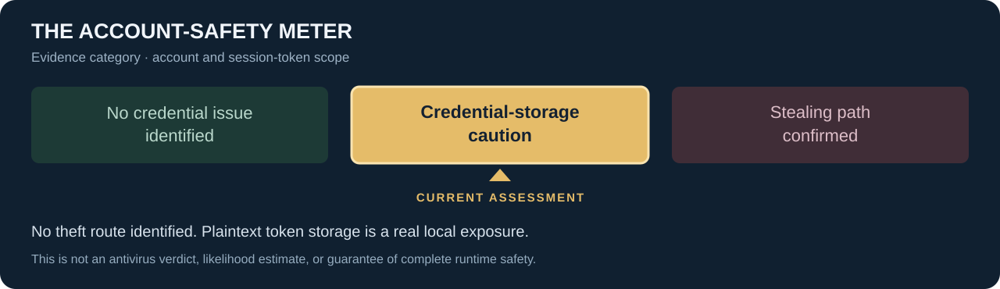
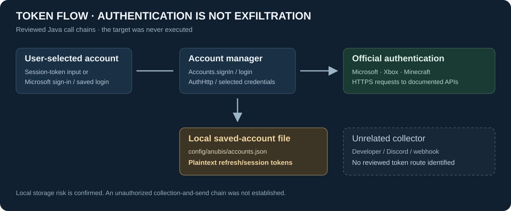
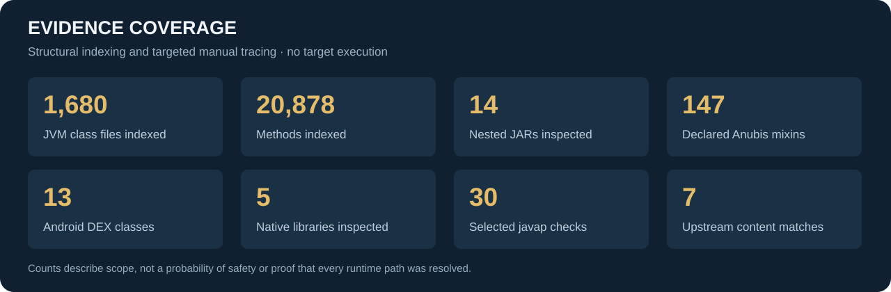

# Anubis · Account & session-token security

**Independent static review of Anubis Beta 0.9.9.1 for Minecraft 1.21.11 / Fabric.**

**No account/session-token stealing path was identified in the reviewed code.** The confirmed account-security weakness is plaintext storage of saved login tokens. Observed token requests go to official Microsoft/Xbox/Minecraft authentication services; no reviewed route sends them to the developer, Discord, a webhook, or another unrelated collector.

| Read this first | Explore the evidence |
|---|---|
| [Full report · 26 sections](reports/ANUBIS-SECURITY-REPORT.md) | [Evidence guide](evidence/anubis/README.md) |
| [Why scanners might flag it](reports/SCANNER-FLAGS.md) | [All declared Anubis mixins](evidence/anubis/MIXINS.md) |
| [Token flow and the real concern](reports/ACCOUNT-TOKEN-REVIEW.md) | [Module inventory](evidence/anubis/MODULES.md) |
| [Methodology and limitations](reports/METHODOLOGY.md) | [Hashes and contextual indicators](evidence/anubis/indicators.json) |

## The assessment



| Evidence check | Result |
|---|---|
| Unauthorized launcher/browser/Discord credential harvesting | **Not identified** |
| Account tokens sent to an unrelated collector | **Not identified** |
| Saved account tokens written without encryption | **Confirmed** |
| Complete certification of native/indirect runtime behavior | **Not established** |

**Current category: Credential-storage caution.** This is an evidence category, not a safe percentage, malware probability, antivirus verdict, or guarantee. Metadata, mixins, cheat features and ordinary network/native capabilities do not by themselves establish account theft. Each sensitive operation needs a caller, trigger, data source and destination.

## Where tokens go



Tokens are **not only stored locally**: user-selected credentials are sent to official services during authentication. Saved Microsoft refresh tokens and Minecraft session tokens are written to `config/anubis/accounts.json`. Anyone able to read that file or an exposed backup may obtain reusable credentials. This is a confirmed local exposure, not a demonstrated theft/export implementation.

Treat the account file and its copies as secrets. Do not share them. Avoid saving a valuable account token if plaintext storage is unacceptable. The published evidence contains no real user's account/configuration secrets.

## Why a tool might flag it

**Keywords:** `access_token` · `refresh_token` · `Bearer` · `HttpClient` · `System.load` · `JNI` · `DexClassLoader` · `Mixin` · `MethodHandles` · `Base64` · `webhook` · `SendInput`.

- **Authentication keywords** belong to deliberate login through official services.
- **Native loading** supports ImGui and an Android image picker. Seven library JARs match published artifact contents apart from added Fabric metadata; custom Android code has narrower assurance.
- **Reflection and bytecode hooks** support Fabric/Mixin, event listeners and compatibility checks.
- **Window inspection/media keys** support Spotify integration without a demonstrated keylogging upload.
- **Discord/webhook references** support status/game notifications; reviewed payloads do not include account tokens.
- **Plaintext saved tokens** remain a real concern. A true “cheat tool” or “native loader” classification is not automatically false; interpreting it as account theft can be unsupported.

No vendor-specific scan results were supplied or reproduced. [The flag guide](reports/SCANNER-FLAGS.md) explains possible heuristics and their evidence, rather than dismissing every antivirus detection.

## Evidence at a glance



The analysis used JADX, CFR, direct class-file parsing, javap, archive inspection, native signatures/symbols/strings, targeted ARM64 disassembly and published-library comparisons. The JAR, target classes/static initializers, nested JARs, DEX and bundled native binaries were **never executed**. Minecraft was not launched.

Decompiler gaps were checked with complementary sources and/or bytecode. Indexing is not a claim that every runtime path was formally proved. Native/JNI indirection, external runtime libraries and independently installed addons limit certainty.

## Exact artifact

| Field | Value |
|---|---|
| File | `Anubis Beta 0.9.9.1.jar` |
| Mod ID / version | `anubisplus` / `0.9.9.1+mc1.21.11` |
| Loader / Java | Fabric / Java 21+ |
| Size | 21,206,373 bytes |
| Analysis date | 2026-10-13 |

**SHA-256**

```text
20a03c38a39d013bf5f6836818c0b665478eb3381181fd372cd661c438fd752a
```

This conclusion applies to those exact bytes. A matching filename, metadata, version or author name is not a substitute for a matching hash. This repository is an independent review, not the mod's upstream project, and does not distribute its binary.

Third-party decompiled evidence retains its original rights/licenses; see [source notice](SOURCE-NOTICE.md).

**Verdict: Mostly safe, minor concerns — with confirmed plaintext credential storage and documented static/native limits.**
