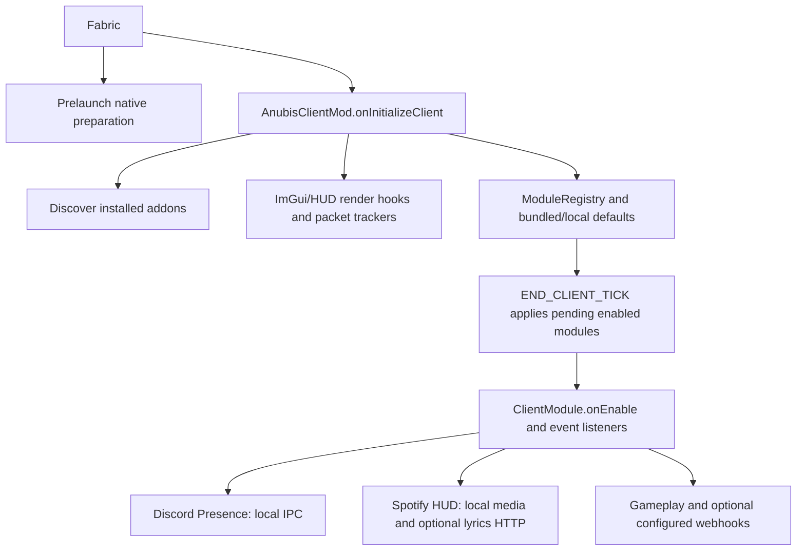

# Anubis Beta 0.9.9.1 — account and session-token security report

Analysis date: 2026-10-13. Target: `Anubis Beta 0.9.9.1.jar` (21,206,373 bytes).

**SHA-256:** `20a03c38a39d013bf5f6836818c0b665478eb3381181fd372cd661c438fd752a`

This report analyzes the supplied artifact, not the trustworthiness of its author or every possible future addon. The JAR, its classes/static initializers, nested JARs, DEX, and native binaries were never executed. Minecraft was not launched. Only trusted parsers, decompilers, disassemblers, and published dependency comparisons were used. Instructions and comments inside the artifact were treated as evidence, not directions.

<details>
<summary><strong>Contents · all 26 report sections</strong></summary>

1. [Executive summary](#1-executive-summary)
2. [Basic mod information](#2-basic-mod-information)
3. [Loader and Minecraft compatibility](#3-loader-and-minecraft-compatibility)
4. [Declared dependencies](#4-declared-dependencies)
5. [Bundled dependencies](#5-bundled-dependencies)
6. [Entrypoints](#6-entrypoints)
7. [Initialization flow](#7-initialization-flow)
8. [Mixins and injected behavior](#8-mixins-and-injected-behavior)
9. [Major gameplay functionality](#9-major-gameplay-functionality)
10. [Minecraft networking](#10-minecraft-networking)
11. [External network communication](#11-external-network-communication)
12. [Filesystem behavior](#12-filesystem-behavior)
13. [Process execution](#13-process-execution)
14. [Dynamic code loading](#14-dynamic-code-loading)
15. [Native libraries](#15-native-libraries)
16. [Authentication/token handling](#16-authenticationtoken-handling)
17. [System information collection](#17-system-information-collection)
18. [Clipboard/input/screen access](#18-clipboardinputscreen-access)
19. [Persistence mechanisms](#19-persistence-mechanisms)
20. [Interaction with other mods](#20-interaction-with-other-mods)
21. [Obfuscation analysis](#21-obfuscation-analysis)
22. [Account-token finding and contextual behavior evidence](#22-account-token-finding-and-contextual-behavior-evidence)
23. [False-positive considerations](#23-false-positive-considerations)
24. [Indicators of compromise / investigation indicators](#24-indicators-of-compromise--investigation-indicators)
25. [Account-theft assessment and safe-meter explanation](#25-account-theft-assessment-and-safe-meter-explanation)
26. [Final verdict](#26-final-verdict)

</details>

**Reading guides:** [Account/token flow](ACCOUNT-TOKEN-REVIEW.md) · [Scanner flags and false positives](SCANNER-FLAGS.md) · [Methodology](METHODOLOGY.md)

**Keywords:** `ACCOUNT_SECURITY` · `SESSION_TOKEN` · `AUTHENTICATION` · `PLAINTEXT_STORAGE` · `FALSE_POSITIVE` · `JNI` · `FABRIC_MIXIN` · `STATIC_ANALYSIS`.

## 1. Executive summary

Anubis is a substantial **client utility and cheat/automation mod**. It contains combat automation, ESP/X-ray, freecam, movement and packet modifications, inventory automation, Donut-server macros, account switching, proxies, an ImGui interface, Discord Presence, and a Windows Spotify HUD.

**Account/session-token theft: no demonstrated stealing or third-party token-exfiltration chain was identified.** The confirmed token-related weakness is plaintext storage of tokens that the user deliberately adds through the account manager. That can expose credentials to someone or another program able to read those files; it is not evidence that Anubis steals accounts.


| Account-safety check | Result | Meaning |
|---|---|---|
| Collect launcher/browser/Discord credentials without the user's action | Not identified | No demonstrated harvesting path in the reviewed code |
| Send Minecraft/Microsoft tokens to an unrelated collector | Not identified | Observed token requests go to Microsoft/Xbox/Minecraft authentication services |
| Save deliberately supplied account tokens unencrypted | **Confirmed** | Medium local credential-exposure risk |
| Hidden shell, remote payload, or persistence chain | Not identified in reviewed Java paths | No demonstrated account-takeover mechanism of those kinds |
| Prove absence of malicious native/indirect runtime behavior | Not established | Static analysis has limits; this is not a safety certificate |

**Meter status: CREDENTIAL-STORAGE CAUTION.** This is an evidence category, not a percentage, probability, antivirus score, or promise of safety. It separates “no stealing path identified” from “saved tokens need protection.”

The only confirmed account/session-token protection weakness in this review is **F1: plaintext saved account tokens**. Saved SOCKS passwords have the same local-storage concern. Microsoft refresh tokens and Minecraft session tokens are reusable secrets; treat `config/anubis/accounts.json` and its backups as sensitive.

Discord status, Spotify lyrics, user-configured game notifications, mod metadata, GUI/native helpers, and gameplay automation are retained below as context. **They do not count as account stealing and do not lower the account-theft meter merely because they use networking, reflection, native code, or ordinary metadata.** No claim that those features transmit account tokens was established.


### Coverage and limits

- Outer archive: 1,287 entries, 36,947,534 expanded bytes, 1,110 Java class files, all class-file major version 65 (Java 21).
- Nested archives: all 14 safely inspected; 570 additional Java class files. Direct class-file parsing indexed **1,680 classes and 20,878 methods**, with zero parser errors, including references and annotations. This is structural coverage, not a formal proof of every runtime path.
- JADX 1.5.3 and CFR 0.152 each produced 663 Java source files for the outer archive. JADX exited 1 with six reported errors; 25 output files contain method placeholders. CFR exited 0 but has six method reconstruction failures in image/model decoding; these occur in different files from the JADX placeholders, and their JADX output and additional javap disassembly are available. Missing Minecraft/third-party types and reconstruction warnings remain. Important conclusions were checked against both source outputs and/or `javap` disassembly. [JADX incomplete methods](../evidence/anubis/jadx-incomplete-methods.json) and [CFR incomplete methods](../evidence/anubis/cfr-incomplete-methods.json) preserve the actual limitations.
- All **147 declared Anubis mixins and 298 annotated hooks/accessors/invokers** were inventoried directly from bytecode. See [complete mixin appendix](../evidence/anubis/MIXINS.md).
- The Android DEX contains 13 classes and decompiles to one outer Java source with inner classes. One callback has incomplete Java reconstruction but an instruction dump is retained. Five native binaries were inventoried; static symbols/strings were inspected, and custom ARM64 picker bridge functions were disassembled.
- No target endpoints were contacted. Seven known library artifacts were fetched from Maven Central for file-content comparison. No running accounts, server connectivity, native runtime compatibility, or actual Minecraft behavior was tested.
- Native indirect calls/JNI, external Minecraft/authlib/JNA implementation, user-supplied URLs, and independently installed addons limit an absolute safety conclusion. A decompiler exit 0 is not proof that reconstructed source is perfect. Nested process sandboxing is unavailable on this host.

Evidence directory: [published static evidence](../evidence/anubis/). [Coverage counts](../evidence/anubis/coverage.json), [decompiler exit codes](../evidence/anubis/decompiler-status.txt), [class index](../evidence/anubis/class-index.json.gz), [nested class index](../evidence/anubis/nested-class-index.json.gz), and [30 selected javap disassemblies](../evidence/anubis/javap/) record the basis of the review.

## 2. Basic mod information

| Field | Value |
|---|---|
| Display name | Anubis |
| Mod ID | `anubisplus` |
| Declared version | `0.9.9.1+mc1.21.11` |
| Author | `4ldenz` (metadata declaration) |
| License | `GPL-3.0-only` |
| Environment | `client` |
| Declared project | `https://github.com/4ldenz/Anubis-client` |
| Java requirement | `>=21`; every outer class is major version 65 |
| Implementation title | `Anubis Client` |

Source: [fabric.mod.json](../evidence/anubis/metadata/fabric.mod.json) and [MANIFEST.MF](../evidence/anubis/metadata/META-INF/MANIFEST.MF). These identify the supplied bytes; authorship and provenance of the whole mod were not independently authenticated. The original attachment and analysis snapshot hashes match.

## 3. Loader and Minecraft compatibility

Fabric metadata requires Minecraft `~1.21.11` and Fabric Loader `>=0.16.0`. The manifest records a build with Minecraft 1.21.11, Fabric Loader 0.19.2, Loom 1.16.3, Gradle 9.4.1, and the `intermediary` mapping namespace. Both Anubis mixin configurations declare `JAVA_21` compatibility.

No outer `quilt.mod.json`, Forge `mods.toml`, NeoForge `neoforge.mods.toml`, `mcmod.info`, or `pack.mcmeta` was found. No outer access-widener or access-transformer file is declared. Native support includes desktop ImGui and custom Android ARM64 compatibility; this does not establish compatibility with every launcher or renderer. Dedicated-server startup is not declared. Compatibility statements are static declarations, not launch-tested results.

## 4. Declared dependencies

Required: `fabricloader >=0.16.0`, `minecraft ~1.21.11`, `java >=21`, `fabric-key-binding-api-v1 *`, `fabric-lifecycle-events-v1 *`, `fabric-rendering-fluids-v1 >=2.0.0`, `fabric-resource-loader-v0 *`, and `fabric-screen-api-v1 *`.

Suggested: `anubis-jsmacros *`. Its implementation is not supplied and cannot be assessed here.

Declared incompatibilities:

| Mod | Constraint |
|---|---|
| embeddium, optifabric, canvas, vulkanmod | Any version |
| optimalaim | `<2.0.0` |
| sodium-blendingregistry, ocrenderfix_sodium | Any version |
| betterfpsdist | `<=1.21-4.5` |
| bobby | `<5.2.4` |
| chunksfadein | `<2.0.2-1.21.2` |
| cull-less-leaves | `<=1.3.0` |
| cullleaves | `<=3.4.0-fabric` |
| custom_hud | `<3.4.2` |
| farsight | `<=1.21-4.3` |
| iceberg | `<1.2.7` |
| movingelevators | `<=1.4.7` |
| notenoughcrashes | `<4.4.8` |
| noxesium | `<2.3.3` |
| reeses-sodium-options | `<2.0.2` |
| fabric-api | `<0.140.0` |
| sodium-extra | `<0.8.0` |
| audio_engine_tweaks | `<1.2.12` |
| sspb | `<6.0.0` |
| moreculling | `<1.6.0-beta.2` |
| simply-no-shading | `<7.6.2` |
| betterend | `<=21.0.11` |
| enchanteds_sodium_options | `<1.0.1` |

These are compatibility restrictions interpreted by Fabric, not evidence of antivirus detection or tampering with installed mods.

## 5. Bundled dependencies

The 14 `META-INF/jars` entries declared in Fabric metadata are:

| Component | Shipped version |
|---|---|
| fabric-api-base | 1.0.5+4ebb5c083e |
| fabric-key-binding-api-v1 | 1.1.7+4fc5413f3e |
| fabric-lifecycle-events-v1 | 2.6.15+4ebb5c083e |
| fabric-rendering-fluids-v1 | 3.1.43+4ebb5c083e |
| fabric-resource-loader-v0 | 3.3.4+4fc5413f3e |
| fabric-resource-loader-v1 | 1.0.10+78c8b4663e |
| fabric-screen-api-v1 | 3.1.7+4ebb5c083e |
| imgui-java-binding, imgui-java-lwjgl3 | 1.90.0 |
| imgui-java-natives-linux, -macos, -windows | 1.90.0 |
| netty-codec-socks, netty-handler-proxy | 4.2.7.Final |

The five ImGui and two Netty JARs differ from the official Maven Central ZIP containers, but **every original non-directory entry has identical content**; the only added entry is `fabric.mod.json`. Thus their classes and desktop native binaries match the published artifacts. This is not a whole-JAR hash match. See [upstream comparisons and hashes](../evidence/anubis/upstream-comparison.json).

Fabric modules were structurally inspected, including their metadata, declared mixins/entrypoints, and method references; their upstream provenance was not separately verified. [Nested inventory](../evidence/anubis/nested-inventory.json) records each archive's metadata, classes, and extraction location. Remaining imports such as Minecraft, authlib, Gson, JNA, LWJGL, and Mixin are runtime dependencies, not additional shaded implementations in the outer JAR. The outer `imgui.*` Anubis classes are custom adapters rather than the complete ImGui dependency.

Other resources include fonts, images, Ogg audio, shaders, JSON defaults/presets/language data, licenses, two `.anc` character-model blobs, and a 19,704-byte Android DEX. `BakedModel` parses `.anc` as compressed model data; `GltfFile` supports embedded GLB data and rejects separately referenced texture files. No standalone shell/PowerShell/batch script, credential certificate bundle, or additional executable payload was identified in the outer inventory. Nested Netty `META-INF/native-image` configuration is build metadata, not a shipped native executable.

## 6. Entrypoints

1. Fabric `preLaunch`: `net.anubis.bootstrap.AnubisNativeBootstrap.onPreLaunch()` → `imgui.AnubisAndroidNative.prepare()`.
2. Fabric `client`: `net.anubis.client.AnubisClientMod.onInitializeClient()`.
3. Mixin plugin: `com.example.client.mixin.indigo.AnubisIndigoMixinPlugin` constructor/`onLoad()`/`shouldApplyMixin()`, invoked by the Mixin framework.
4. All configured Mixin callbacks execute when their target Minecraft/Indigo methods run. Accessors expose fields and invokers expose methods rather than independently scheduling execution.
5. Fabric lifecycle/tick callbacks, the internal event bus, enabled module handlers, GUI actions, and asynchronous workers become secondary entry routes.
6. `AddonManager` discovers other installed mods' **`anubis`** entrypoint containers and calls `onRegisterCategories()`, `onInitialize()`, and later `onConfigLoaded()`. There is no `anubis` addon implementation declared by this artifact itself.
7. Direct indexing found 323 outer classes with `<clinit>` methods. Their initializer references are retained in the class index; caches, constants, GUI objects, module registries, workers, platform checks, and compatibility probes account for the reviewed initialization patterns. None was executed during analysis.

No Java-agent `Premain-Class`/`Agent-Class`, outer `META-INF/services` provider, Forge `@Mod` route, or custom downloaded-class bootstrap was found. Fabric dependencies have their own loader-managed routes, listed in the nested metadata inventory.

## 7. Initialization flow



`onInitializeClient()` installs render callbacks, chunk/block/light trackers, combat tracking, borderless-window ticks, toasts, profile autoload, shutdown saves, and the GUI key (GLFW 344, Right Shift). `ModuleConfigStore.load()` adopts bundled defaults and existing local configuration. Its pending module activations run on `END_CLIENT_TICK`.

`ClientModule.switchTo(true)` registers event handlers and calls `onEnable()`, rolling back activation on failure. Mixins dispatch tick, rendering, input, chat, and packet events into these listeners. `ModuleKeybinds` enables/toggles modules only in the configured game/input context. Shutdown saves layouts/configuration and flushes chunk caches.

Fresh defaults enable Discord Presence through its `enabledByDefault()` method. Spotify HUD is enabled by the shipped `assets/anubis/defaults/modules.json`; its constructor defaults enable online lyrics. Existing user configuration can override both. [BundledDefaults](../evidence/anubis/sources/cfr/net/anubis/client/config/BundledDefaults.java), [ModuleConfigStore](../evidence/anubis/sources/cfr/net/anubis/client/config/ModuleConfigStore.java), and the shipped defaults establish reachability rather than merely the presence of network APIs.

## 8. Mixins and injected behavior

The main required configuration declares 146 client mixins; the optional Indigo configuration declares one and applies it only when `fabric-renderer-indigo` is installed. The appendix records **each target, method/field descriptor, injection type, injection point/ordinal/target/shift where declared, cancellation flag, and Anubis delegate** from actual class-file annotations. Exact shipped intermediary identifiers are retained; informal named targets below follow the mixin class names and code context rather than a separately supplied Minecraft mapping set.

| Important mixin group | Behavior |
|---|---|
| MixinMinecraft | Replaces the title screen/window title when enabled; dispatches pre/post ticks; drains asynchronous events; adjusts interaction for AutoEat |
| MixinClientConnection | Cancellable HEAD hooks on receive/send (`method_10770`, `method_52906`); dispatches packet events and tracks outgoing rotations |
| MixinClientPacketListener | Cancellable chat-send hook; TAIL hooks after login, chunk/block/section/light updates and entity motion |
| MixinProxyConnection / ProxyServerStatusPinger | Wraps Minecraft/server-list connection initializers with configured SOCKS routing |
| AccessorAccountsMinecraft | Mutable access to user/session-related API, social/profile/key/reporting fields for deliberate account switching |
| KeyboardHandler / MouseHandler / MovementCorrectionKeyboardInput | GUI/input event routing and movement correction; no demonstrated global keyboard hook |
| BoatFly / Fly / Jesus / Sneak / Speed / AirStuck / Elytra / EntityControl | Movement, on-ground state, collision/input/timer, vehicle or setback behavior changes |
| MultiPlayerGameMode / Rotation / Mace / FriendGuard / SpeedMine | Attack, interaction, rotation, mining, or friend-protection modifications |
| NameProtect / FakeStats / TranslationGuard | Alters displayed names, scoreboard/tab/sidebar text, and presentation of Anubis translation/keybind data |
| BlockState / Block / VisGraph / SectionCompiler / ModelBlockRenderer / Indigo terrain context | X-ray/visibility/render filtering and ESP support |
| GameRenderer / LevelRenderer / Gui / PlayerRenderer and visual subgroups | HUD, glow/ESP, sky/fog/light, camera/freecam, skins/cosmetics, hands, particles, blur and grading |
| NoInvLeak / LoadingOverlay / Screen / Window | Inventory presentation, overlays, startup/loading/menu UI, and window behavior |

Annotation counts: 148 Inject, 48 Accessor, 4 Invoker, 26 WrapOperation, 24 ModifyExpressionValue, 18 ModifyReturnValue, 12 ModifyArg, 10 ModifyVariable, 6 WrapMethod, 1 Redirect, and 1 WrapWithCondition. No declared Overwrite, ModifyArgs, or ModifyConstant hook was found. These counts include accessors/invokers as hooks and must not be confused with the mixin count.

The Indigo plugin's ASM `preApply()`/`postApply()` methods are empty. No separate Anubis coremod, instrumentation agent, ByteBuddy/Javassist implementation, or hidden ASM class rewriting chain was found. Standard Mixin/Fabric bytecode transformation and event-listener lambda generation are present.

## 9. Major gameplay functionality

There are 131 direct `ClientModule` subclasses. The builtin provider explicitly constructs 129 of them; `HeadCosmeticModule` is additionally constructed by `PharaohHeaddressModule`. No direct construction of packaged `RiptideModule` was found, so it is not assumed to be an independently reachable feature. [Module inventory](../evidence/anubis/MODULES.md) lists IDs, names, descriptions, classes, and fresh-default settings; a packaged class alone does not prove registration.

| Category | Demonstrated implementations |
|---|---|
| Combat | AimAssist, KillAura, Triggerbot, CrystalAura/Optimizer/Macro, AnchorAura, Mace, ShieldBreaker, AutoTotem, AutoCity, WTap, FastXp, KeyThrow and related attack/inventory timing |
| Movement | Fly, Speed, ElytraFly/Swap, BoatFly/Noclip, Jesus, Spider, EntitySpeed/Control, ClickTp, Sprint, Sneak, AutoWalk/Jump, TridentBoost |
| World visibility | Xray, player/storage/block/glow/target/hole ESP, chunk/spawner/netherite scanning, anti-vanish/staff detection, radar, region map |
| Automation | AutoClicker, inventory replenish/tool/eat, reconnect/relog, chat macros/spam, seller/order/auction/teleport/Donut-server macros, spawner protection and panic payment |
| Presentation | Freecam/Freelook, custom skins/characters, Fullbright, nametags, HUD, crosshair/FOV, hands/weapon inspection, fog/weather/time, particles, blur, grading, menu/theme customization |
| Privacy/local utility | NameProtect, NoInvLeak, FakeStats, accounts/proxies, Discord Presence, Spotify media/lyrics |

These are implemented behaviors, not malware indicators by themselves. For example, AutoClicker calls in-game interaction/attack helpers; Fly replaces or edits movement packets and can implement anti-kick motion; BoatFly optionally cancels vehicle-correction packets. Local inventory automation issues normal server-bound actions. Chat macros and Donut routines send configured commands such as `shop`, `sell`, teleport commands and `/pay`; these are Minecraft commands, not shell commands. No additional block/item content registry was identified beyond client sound/assets/cosmetic presentation.

## 10. Minecraft networking

No Anubis `ClientPlayNetworking`/`ServerPlayNetworking` registration, `PayloadTypeRegistry`, Forge/NeoForge channel, or custom payload/channel implementation was found in the supplied Java references and sources. The mod primarily intercepts and generates **vanilla Minecraft packets**. Its custom names refer to internal events, not wire-level custom channel IDs.

| Path | Direction/data | Handler/result |
|---|---|---|
| PacketSendEvent through MixinClientConnection | Client → server; existing/generated packet objects | Enabled module callbacks may cancel/edit/replace sends; outgoing rotations tracked |
| PacketReceiveNettyEvent / PacketReceiveEvent | Server → client; received gameplay packets | Synchronous cancellation and asynchronous game-thread processing |
| PacketAppliedEvent | Server → client; login, chunk/block/light/motion state | Runs trackers, scanners and local profile-on-join logic after vanilla application |
| Fly/Jesus/Speed and related accessors | Client → server; position, yaw/pitch, on-ground and movement state | Movement spoofing/anti-kick, water/collision adaptations |
| BoatFly | Both; vehicle motion/correction | Anti-kick handling; optional cancellation of correction (`class_2692`) |
| AirStuck | Client → server; movement/input packets | Cancels selected movement/input while enabled |
| Combat/inventory automation | Client → server; attack/use/dig, selected slots and inventory actions | Acts as the player's current session, with server-side permission checks |
| Chat/Donut automation | Client → server; chat and commands | Sends user/configured server commands, including optional payments and shop/sell actions |

A server can trigger normal packet-driven events, and configured local profiles/modules can change settings or perform actions in response. No incoming packet → arbitrary OS command, downloaded code, credential export, or unrestricted remote admin action chain was identified. Malformed input, high-rate automation, cancellations and spoofing can still cause desynchronization, crashes, or anticheat enforcement; their runtime robustness was not tested.

## 11. External network communication

Direct Java network references were indexed into [33 network-related method sites](../evidence/anubis/network-bytecode-sites.json). URI parsing/IDN helpers in that list do not all open connections. The actual communication chains follow:

| Trigger/call chain | Destination, method and transmitted data | Headers/notes |
|---|---|---|
| ConnectionsPanel Microsoft action → Accounts.addMicrosoft → signIn worker → microsoftBrowserSignIn → MicrosoftLogin.requestDeviceCode / awaitApproval | POST `https://login.live.com/oauth20_connect.srf` and `/oauth20_token.srf`; public client ID, scope, device-code grant and approval polling | Form URL encoding; `Accept: application/json`, `User-Agent: AnubisClient`; browser opens server-returned verification URI with user code |
| ConnectionsPanel saved Microsoft login → Accounts.login → MicrosoftLogin.refresh | POST token endpoint; saved refresh token, public client ID and scope | HTTPS; redirects explicitly disabled by AuthHttp |
| MicrosoftLogin.minecraft → signedPost | POST `https://device.auth.xboxlive.com/device/authenticate` then `https://sisu.xboxlive.com/authorize`; generated random device UUID, EC proof key, MSA access token, device token, relying parties | JSON, `Signature`; device request adds `x-xbl-contract-version: 1`; no disk/hardware-derived device ID demonstrated |
| MicrosoftLogin.minecraft → AuthHttp.postJson / get | POST `https://api.minecraftservices.com/launcher/login` with XSTS identity; GET `/minecraft/profile` with Minecraft access token | JSON; profile uses `Authorization: Bearer <token>` |
| ConnectionsPanel session-token input or saved login → Accounts.addSession/login → SessionLogin.signIn → AuthHttp.get | GET Minecraft profile using deliberately supplied/saved session token | Same legitimate profile endpoint; no third-party token destination found |
| Accounts.signIn → GameSession.prepare → authlib UserApiService / profile API | Mojang account/user properties and profile lookups using selected credentials/UUID | Delegated Minecraft/authlib requests; exact downstream wire endpoints/headers are outside this JAR |
| Enabled SkinChange → reloadIfChanged/loadFromUsername → fetchUUID/fetchSkin → registerSkin | GET `https://api.mojang.com/users/profiles/minecraft/<username>` and `https://sessionserver.mojang.com/session/minecraft/profile/<uuid>?unsigned=false`; then downloads the skin URL returned inside Base64 texture metadata | `User-Agent: Anubis/1.0`; timeout 5s. Texture URL is response-defined, normally Mojang texture hosting, not a hardcoded artifact IOC. Signature verification of that texture response is not implemented in fetchSkin itself |
| Fresh Spotify HUD → Poller reads Spotify → HUD lyrics lookup → LyricsService.lookup/resolve → get/search → send/exchange | GET `https://lrclib.net/api/get?track_name=…&artist_name=…&album_name=…&duration=…`; fallback `/api/search?track_name=…&artist_name=…` | `Accept: application/json`; `User-Agent: Anubis Client/<mod-version> (https://github.com/4ldenz/Anubis-client)`; caches, pacing, capped responses, redirect NEVER |
| Enabled PlayerDetection → TickEvent → handlePlayerDetection → sendWebhookNotification → WebhookService.send | POST configured URL; detected player names, server display name, timestamp, optional payment target/amount, optional Discord mention; Anubis username/avatar URL | `Content-Type: application/json`; URL validation permits any HTTP or HTTPS host, not just Discord |
| Enabled SpawnerProtect → tick/block-update detection → sendWebhook → SpawnerAlerts.send/post | POST configured URL; local player name, dimension, own XYZ; event-specific nearby player/name/location, block location/counters, spawner inventory totals and timing | JSON UTF-8; retry on 429. Blank default URL suppresses sends; not automatically aimed at a developer URL |
| ConnectionsPanel proxy check action → ProxyChecker.check/pump/start → ProxyRouting.handler → Netty Bootstrap.connect | Configured SOCKS4/5 proxy asks for a TCP tunnel to **1.1.1.1:443**; may send proxy username/password during SOCKS authentication | Connectivity/latency probe, then closes; no HTTP payload, game token or telemetry body identified |
| DiscordPresence default activation → Link.run/connect/send → DiscordIpc.setActivity | Local Windows `\\.\pipe\discord-ipc-0..9`, or Unix `discord-ipc-0..9` beneath temp/runtime/app/snap locations; PID, application ID, server/menu status, start time, logo and community button | `SET_ACTIVITY` RPC. Discord can publish received presence through its own connection; no direct Java Discord HTTP token login |

Direct HTTPS requests use default port 443. Configured webhook/proxy ports vary; HTTP webhooks may use port 80 or an explicitly supplied port. No Java TCP listener/server socket, WebSocket, UDP telemetry, host/IP fingerprint-upload routine, screenshot/file-upload endpoint, or hidden developer webhook was found.

`https://discord.gg/anubis` is a user-initiated community/browser link and a Rich Presence button, not a hardcoded collection endpoint. `https://github.com/…` appears in metadata, support links, and a lyrics User-Agent. `https://i.imgur.com/W3cTqvc.png` is a JSON avatar URL sent to the webhook receiver; no Java code in this artifact fetches it directly. `http://auth.xboxlive.com` and `rp://api.minecraftservices.com/` are protocol relying-party strings inside HTTPS authentication requests, **not plaintext HTTP requests made to those literal URLs**.

Known recipient services naturally observe the connection's public IP and HTTP headers. That is distinct from the mod explicitly querying or including a public IP, hostname, HWID, browser data, launcher credentials, files, screenshots or clipboard in a request body; no such collection/upload chain was found. Literal strings are retained in [URL inventory](../evidence/anubis/url-string-inventory.json); dynamically supplied/returned URLs cannot be enumerated from one static artifact.

## 12. Filesystem behavior

[Filesystem bytecode sites](../evidence/anubis/filesystem-bytecode-sites.json) and [source inventory](../evidence/anubis/filesystem-lines.txt) identify direct operations. Most mod-managed state is under Fabric's configuration directory, in `anubis/`:

| Location | Contents / callers |
|---|---|
| accounts.json | Account types, names, UUIDs and plaintext token secrets; Accounts.load/save |
| proxies.json | Proxy addresses/ports, selected configuration, plaintext usernames/passwords; Proxies.load/save |
| modules.json and migration backups | Module settings/enabled states/private values; ModuleConfigStore |
| profiles/*.json | Local/imported/exported profiles, server-bound autoload and bundled presets; ConfigProfiles |
| friends.json | Friend settings; FriendStore |
| theme.json, hud_theme.json, hud.json, clickgui.json, gui.ini | UI/HUD/theme/window placement; ThemeStore, HudTheme, stores and ImGui |
| backgrounds/ | User-selected image copies and GPU texture decode; ThemeImages |
| characters/ and .baked/ | User GLB/ANC models and compiled-model cache; CustomCharacters |
| lyrics-cache/ | Track-keyed lyrics JSON with pruning; LyricsDiskCache |
| playerbypass-protected/ | Server/dimension-keyed protected-chunk data; ProtectedChunkStore |

Minecraft/authlib also uses the game directory for selected-session profile-key management, and SkinChange uses a cache under the game directory for downloaded textures. Many stores write sibling `.tmp` files then replace atomically/fallback; they do not create OS startup entries.

Separate, justified accesses include: home/Downloads as the initial file-dialog directory; user-picked files for profile, proxy-list, image/model import/export; local Discord pipe/socket discovery in temp directories; language JSON in installed Anubis/dependent mods for TranslationGuard; temporary native extraction; and Android picker result/image files. The Android native bridge reads `/proc/self/maps` to find the launcher's loaded runtime/bridge, not a remote process memory dump.

No browser credential store, Discord LevelDB/token-store scan, SSH key directory, OS credential vault, arbitrary Desktop/Documents sweep, antivirus database, or launcher-account database read was identified. Native debug paths mentioning a developer's Windows home directory are compile-time strings, not proof of accessing the current user's files.

## 13. Process execution

Direct bytecode-reference checks across outer and nested Java classes found **zero Runtime.exec or ProcessBuilder calls**. Bootstrap method-handle arguments were also checked: the only selected standard-API handles were HttpRequest.Builder.header and System.nanoTime, not a hidden method-reference process/loader path. `Runtime.getRuntime().availableProcessors()` sizes the character-model worker pool; it does not spawn a process. `ProcessHandle.current()` reads this process's PID/start time for Discord Presence.

Minecraft's platform URL/folder opener is invoked for deliberate Microsoft sign-in, community links, mods/profile/character directories. The actual browser/file-manager process is delegated to Minecraft/OS utility code and is outside this artifact. TinyFileDialogs delegates user-initiated desktop dialogs to an existing LWJGL native dependency; platform dialog helper processes cannot be ruled out without that external implementation. No uploaded shell command, PowerShell/CMD/Bash/AppleScript payload, or hidden executable spawn was found. The custom Android picker bridge's reviewed native imports/direct calls do not show process-spawn APIs.

## 14. Dynamic code loading

Four distinct mechanisms are present:

1. **Installed addons:** Fabric creates `anubis` entrypoints from other installed mods. AddonManager calls their lifecycle functions. This grants normal mod-level privileges to installed addons; no addon download/install loop appears here.
2. **Event dispatch:** EventBus inspects annotated methods/fields, and LambdaListenerFactory uses MethodHandles and LambdaMetafactory to create listeners for existing loaded classes. This is standard listener adaptation, not encrypted or downloaded bytecode.
3. **Iris compatibility:** ShaderOverlay checks `isModLoaded("iris")`, reflects `net.irisshaders.iris.api.v0.IrisApi.getInstance()`, and binds `isShaderPackInUse` to decide rendering behavior.
4. **Android picker:** User image-picker action → AndroidSystemPicker.prepareRuntime → extracts bundled `classes.dex` and `libanubis_picker.so` → System.load → nativeOpen → native bridge's DexClassLoader → `net.anubis.picker.AndroidImagePicker.launch`. The DEX uses Android launch/activity-result APIs and reflection/dynamic proxies to present `ACTION_OPEN_DOCUMENT` restricted to images and copy a selected image into a private result directory.

The final mechanism **does obtain executable code from bundled resources at runtime**, so it must not be mislabeled “no dynamic code.” No network download → loader → execution chain was found. Outer Java references contain no URLClassLoader, defineClass/defineHiddenClass, Unsafe call, or Java agent API. Native/JNA calls and installed addon code remain separate runtime trust surfaces.

## 15. Native libraries

| Binary | Platform / origin / loading route |
|---|---|
| io/imgui/java/native-bin/android-arm64/libimgui-java64.so | Custom ARM64 Android ImGui, SHA-256 `527f815cba3b15a217797fb3a7a0c080f68e42d103ace51121eca04b1f0cd111`; preLaunch prepare extracts/validates ELF and sets imgui.library.path; ImGui dependency subsequently loads it for GUI use |
| net/anubis/compat/android-picker/arm64-v8a/libanubis_picker.so | Custom ARM64 image-picker JNI bridge, SHA-256 `737abae16904ce3d5938b213d60fba7f8d2a2c80952715474fa4dbfae99d1e1c`; explicit System.load during user picker request |
| imgui-java64.dll in Windows native JAR | x86-64 desktop ImGui; `5f0cb2709a97043f8de42fc3bfb9d2f84808448dc9c605c8aac635b955dc6c24`; matches Maven artifact contents |
| libimgui-java64.so in Linux native JAR | x86-64 desktop ImGui; `3198e517a37d36fad7a8c3c928cae2ee6f71f2401dbc374731f8a4d9770060ef`; matches Maven artifact contents |
| libimgui-java64.dylib in macOS native JAR | Universal x86-64/ARM64 ImGui; `da6db90baec7f227a06fbf38fc4b776558548f742899706460afd5cf1660d59a`; matches Maven artifact contents |

`imgui.ImGui` in the nested binding contains System.load/loadLibrary; Anubis GUI rendering reaches ImGui initialization. Custom Android preparation accepts explicit launcher JVM-property overrides, validates architecture/header and uses private temporary directories; this is not a cryptographic signature check of an override. Windows JNA accesses system `user32`/`combase` and existing JNA User32/Kernel32/GDI32 functions for window/media integration. These OS libraries are not additional bundled DLLs.

Static analysis used file signatures, ELF dynamic dependencies/symbols, PE imports, strings, and content comparison. GNU objdump cannot parse the Mach-O here; file/strings and exact native-content matching remain available. Capstone 5.0.6/pyelftools 0.32 disassembled **six picker bridge/helper functions, 3,633 instructions**. JNI exports match AndroidSystemPicker.nativeOpen/nativeCancel; direct calls include file/mapping reads, environment lookup, dlopen/dlsym and JNI helper calls. Strings identify `/proc/self/maps`, `libart.so`, existing Pojav/AWT bridges, DexClassLoader and AndroidImagePicker. No direct network or shell-spawn call was identified in that pass.

This is a targeted native review, not a complete symbolic proof of both custom libraries. Indirect JNI/dlsym calls cannot be fully resolved from imports alone. [Native inventory](../evidence/anubis/native-inventory.json), [symbols/strings](../evidence/anubis/native/), [picker disassembly](../evidence/anubis/native/android-picker-disassembly.txt), and [DEX index](../evidence/anubis/android-dex-index.json) preserve the evidence.

## 16. Authentication/token handling


The account GUI deliberately accepts session tokens, provides offline/cracked names, and starts Microsoft device-code authentication. `MicrosoftLogin` generates an EC proof-of-possession key and uses legitimate Microsoft/Xbox/Minecraft endpoints. The hardcoded `00000000402b5328` is a **public OAuth client/application identifier**, not a harvested secret/API password. The generated device UUID is random, not demonstrated HWID extraction.

`Credentials.secret` holds a Microsoft refresh token for Microsoft accounts or the supplied session token for session accounts. Accounts.remember → save stores it in `accounts.json` under `token`. It is reused for the selected account login and intentionally replaces the Minecraft session/API objects through the account accessors. No unattended extraction of the launcher's existing access token was found: reviewed uses of Minecraft's user object obtain display name/UUID or construct a selected session.

Account.toString returns only type/name, so the “Switched session to {}” log is **not** evidence of token logging. Other record toString implementations could contain secrets if called, but no reached logging chain for those token records was demonstrated. No browser/Discord password theft, cookie harvesting, third-party bearer-token transmission or embedded live webhook token was identified. Plaintext storage remains F1 regardless of that negative finding.

## 17. System information collection

Reviewed uses are limited and purpose-specific:

- OS/architecture/runtime properties and selected environment/temp variables: Android detection/native preparation, Discord socket discovery, and JNA/platform gating.
- Current PID and process start time: local Discord RPC and Rich Presence timestamps.
- Processor count: character-cache worker sizing.
- OpenGL renderer/version/vendor: GUI diagnostics and AMD DSA compatibility; logged locally, not part of a demonstrated fingerprint request.
- Visible Windows handles/PIDs/executable paths: SpotifyWindow.EnumWindows → GetWindowThreadProcessId → OpenProcess with query access → QueryFullProcessImageName; filters for `spotify.exe` before title use.
- Native self memory-map paths: Android runtime bridge discovery.

No Java chain was identified for collecting CPU/GPU serials, MAC address, disk identifiers, Windows SID/machine GUID, hostname, security software inventory, installed-app databases, or public/local IP into a telemetry body. The Spotify process-name checks are genuine system reconnaissance at a limited local level, so they are not omitted merely because their purpose appears legitimate.

## 18. Clipboard/input/screen access

Clipboard reads/writes occur in explicit profile/theme/module-code import/export actions and proxy-list paste/copy; CoordSnapper copies coordinates. ImGui's expected clipboard handling also exists. No clipboard polling → token search → external send loop was found.

Keyboard/mouse mixins and GLFW polling address the Minecraft window. Spotify media-key acceptance requires enabled media keys, no open game screen, focused game, and a player; it then sends **system-wide Windows media keys** (play/pause, next, previous). This affects another application outside Minecraft but is not keylogging.

No direct AWT Robot, desktop screen-capture, global keyboard-hook, ReadProcessMemory credential scraper, or screenshot-upload chain was identified. NoInvLeak's Windows overlay uses `SetWindowDisplayAffinity(..., 17)` (`WDA_EXCLUDEFROMCAPTURE`) and draws inventory presentation in a capture-excluded window; it is an intentional stream/capture concealment feature, not screenshot acquisition. ShaderOverlay.capture captures rendering commands/state, not a desktop screenshot.

## 19. Persistence mechanisms

No demonstrated Windows Run/RunOnce registry writes, startup-folder installation, scheduled task, launch agent, cron modification, launcher patch, copied executable startup, or rewritten mod was found. Direct Java registry/persistence API checks returned no hits.

Configuration, tokens, profiles, cache files and mod-selected native resources can persist on disk. That is **data persistence**, not evidence that code survives removal from the mods folder. Temporary custom Android native/picker files have cleanup/delete-on-exit paths; abnormal termination can leave files without an autostart mechanism.

## 20. Interaction with other mods

Explicit runtime checks: `sodium` (Xray compatibility/rebuild handling), `iris` (shader API reflection), and `fabric-renderer-indigo` (optional terrain mixin gating). Fabric metadata enumerates the incompatibilities in section 4. The suggested `anubis-jsmacros` addon is optional and external.

AddonManager discovers installed addons through `anubis` entrypoints and permits module providers/registration during startup. TranslationGuard enumerates installed mods but selects Anubis and mods declaring a dependency on `anubisplus`; it reads their language resources and filters associated UI/translation/keybind presentation. Its code does not rewrite those mods' JARs. No automatic download, deletion, patching, antivirus-mod detector, or security-tool-specific environment hiding was found.

## 21. Obfuscation analysis

The mod is mostly readable: meaningful `net.anubis.client.*` package/class/method names and descriptive module IDs/settings. `com.example.client.mixin` looks like a retained template package. Minecraft's `class_####`, `method_####`, and `field_####` names are explicitly shipped **intermediary mappings**, not by themselves obfuscation of Anubis behavior.

Record ObjectMethods bootstrap, compiler lambdas, StringConcatFactory and LambdaMetafactory account for much of invokedynamic usage. No encrypted-string table, AES decoder, deliberate control-flow flattening, or decrypt → download → execute chain was found. Decompiler warnings are not proof of obfuscation.

Base64/compression uses have identifiable purposes: Mojang texture metadata, OAuth ECDSA signature/JWK encoding, compressed share/profile codes, embedded model/image data, and `.anc` model compression. Their routines were read without executing target decoding code. The literal URL inventory recovers endpoints without invoking the mod. No hidden endpoint/OS command or hardcoded live user credential was recovered. Native build paths and compiler/runtime strings are provenance/debug data, not a demonstrated runtime collection destination.

## 22. Account-token finding and contextual behavior evidence

### F1 — Confirmed credential-protection weakness: plaintext account and proxy secrets

**Severity:** Medium. **Confidence:** High. **Status:** Confirmed storage behavior; no demonstrated theft.

**Package/class/method:** `net.anubis.client.account.Accounts.save/configPath/remember`, `MicrosoftLogin.minecraft`, `SessionLogin.signIn`; `net.anubis.client.proxy.Proxies.save/configPath`.

**Evidence (CFR, corroborated by JADX and javap):**

```java
// Accounts.save
if (!account.secret().isEmpty()) {
    entry.addProperty("token", account.secret());
}
// configPath
FabricLoader.getInstance().getConfigDir().resolve("anubis").resolve("accounts.json");
// Proxies.save
entry.addProperty("password", proxy.password);
```

**Call chain/trigger:** ConnectionsPanel account action → Accounts.addMicrosoft/addSession/login → signIn → credentials → remember → save. Proxy edit/import → Proxies mutation/save. **Data/destination:** Microsoft refresh token/session token in config/anubis/accounts.json; proxy credentials in config/anubis/proxies.json. No encryption/keyring or explicit private POSIX permissions is applied by those save routines; file permissions inherit host settings. Copying/backing up those files exposes reusable secrets. Account.toString redaction reduces a separate logging concern but does not protect disk storage.

Sources: [CFR Accounts](../evidence/anubis/sources/cfr/net/anubis/client/account/Accounts.java), [JADX Accounts](../evidence/anubis/sources/jadx/net/anubis/client/account/Accounts.java), [javap Accounts](../evidence/anubis/javap/net.anubis.client.account.Accounts.txt), [CFR Proxies](../evidence/anubis/sources/cfr/net/anubis/client/proxy/Proxies.java).

### F2 — Default server-address disclosure through Discord Presence

**Account-theft classification:** Informational context; no account-token transmission established. **Confidence:** High. **Status:** Confirmed default Rich Presence behavior, conditional on Discord connection/publication settings.

**Class/method:** `net.anubis.client.module.impl.misc.DiscordPresenceModule.enabledByDefault/place/activity`, inner `Link.run/send`; `net.anubis.client.discord.DiscordIpc.setActivity`.

```java
private final BooleanSetting showServerIp =
    this.addSetting("show-server-ip", new BooleanSetting("Show Server IP", true));
public boolean enabledByDefault() { return true; }
// place
return this.showServerIp.get() ? server.field_3761 : "Multiplayer";
// activity / local IPC
activity.addProperty("details", card.details());
command.addProperty("cmd", "SET_ACTIVITY");
```

**Call chain/trigger:** Fabric client init → config/default activation on tick → onEnable → Link worker → refresh/place → activity → DiscordIpc.setActivity. **Data:** server address, menu/world status, timestamps and local PID; no game token. **Destination:** local Discord RPC, then Discord's own presence publication. A private server address can be revealed without separately enabling a webhook. Disable the module or Show Server IP if undesired.

Sources: [CFR DiscordPresenceModule](../evidence/anubis/sources/cfr/net/anubis/client/module/impl/misc/DiscordPresenceModule.java), [JADX equivalent](../evidence/anubis/sources/jadx/net/anubis/client/module/impl/misc/DiscordPresenceModule.java), [javap](../evidence/anubis/javap/net.anubis.client.module.impl.misc.DiscordPresenceModule.txt), [Discord IPC](../evidence/anubis/sources/cfr/net/anubis/client/discord/DiscordIpc.java).

### F3 — Default-enabled online lyrics expose listening metadata

**Account-theft classification:** Informational context; no account-token transmission established. **Confidence:** High. **Status:** Confirmed conditional default lyrics feature.

**Class/method:** `net.anubis.client.module.impl.client.SpotifyHudModule` defaults/Poller/lyrics; `net.anubis.client.util.spotify.LyricsService.get/search/send/exchange`.

```java
// shipped modules.json
"spotify-hud": { "enabled": true, ... }
// constructor
new BooleanSetting("Lyrics Online", true);
// LyricsService
send(withQuery("api/search", "track_name", title, "artist_name", artist));
HttpRequest.newBuilder(uri).header("User-Agent", this.userAgent)
    .header("Accept", "application/json").GET().build();
```

**Call chain/trigger:** default module activation on supported Windows runtime → Poller uses MediaSession/SpotifyWindow → HUD requests lyrics → lookup/resolve → cache miss with online enabled → get/search → HttpClient. **Data/destination:** title, artist, album/duration where available, mod-version User-Agent and implicit connection IP, to lrclib.net over HTTPS. No account token, arbitrary window title or clipboard is included in the reviewed requests. Disable Lyrics Online or Spotify HUD to suppress online lookup.

Sources: [CFR SpotifyHud](../evidence/anubis/sources/cfr/net/anubis/client/module/impl/client/SpotifyHudModule.java), [CFR LyricsService](../evidence/anubis/sources/cfr/net/anubis/client/util/spotify/LyricsService.java), [JADX LyricsService](../evidence/anubis/sources/jadx/net/anubis/client/util/spotify/LyricsService.java), [javap LyricsService](../evidence/anubis/javap/net.anubis.client.util.spotify.LyricsService.txt), [shipped defaults](../evidence/anubis/metadata/assets/anubis/defaults/modules.json).

### F4 — Configured webhooks disclose game/player/location data and permit HTTP

**Account-theft classification:** Informational context; reviewed payloads contain game data, not account tokens. **Confidence:** High. **Status:** Confirmed optional configured notifications; no hidden fixed collector identified.

**Class/method:** `PlayerDetectionModule.handlePlayerDetection/sendWebhookNotification/isValidWebhookUrl`, `WebhookService.send`; `SpawnerProtectModule.sendWebhook`, `SpawnerAlerts.post`.

```java
// PlayerDetection validation (CFR; JADX placeholder resolved by javap)
return uri.getHost() != null &&
    ("https".equalsIgnoreCase(scheme) || "http".equalsIgnoreCase(scheme));
// SpawnerProtect fields
fields.add(SpawnerAlerts.field("Account", playerName, true));
fields.add(SpawnerAlerts.field("Your location", coordinates(playerPos), false));
// actual send
HttpRequest.newBuilder(URI.create(url)).header("Content-Type", "application/json")
    .POST(HttpRequest.BodyPublishers.ofString(payload)).build();
```

The final snippet is shortened to show the actual operations; literal labels are decorated with emoji in the shipped spawner code.

**Call chains/triggers:** enabled PlayerDetection tick → new players → optional webhook flag → executor → WebhookService; enabled SpawnerProtect tick/block/player event → nonblank configured URL → SpawnerAlerts worker. **Data:** detected/own names, server display name in PlayerDetection, coordinates/dimension in SpawnerProtect, event/timestamp/inventory and optional payment/mention details. **Destination:** user-configured HTTP(S) URL; no hostname restriction. Fresh default URL is blank, PlayerDetection's webhook switch is false, and these modules are not default enabled. URLs are marked private settings and shared-profile import/export skips private values. HTTP configuration exposes the payload to plaintext transport; HTTPS is preferable. There is no demonstrated reading of local credentials into these payloads.

Sources: [CFR PlayerDetection](../evidence/anubis/sources/cfr/net/anubis/client/module/impl/misc/PlayerDetectionModule.java), [JADX PlayerDetection](../evidence/anubis/sources/jadx/net/anubis/client/module/impl/misc/PlayerDetectionModule.java), [javap PlayerDetection](../evidence/anubis/javap/net.anubis.client.module.impl.misc.PlayerDetectionModule.txt), [CFR SpawnerProtect](../evidence/anubis/sources/cfr/net/anubis/client/module/impl/misc/SpawnerProtectModule.java), [javap SpawnerProtect](../evidence/anubis/javap/net.anubis.client.module.impl.misc.SpawnerProtectModule.txt), [WebhookService](../evidence/anubis/sources/cfr/net/anubis/client/webhook/WebhookService.java).

### F5 — Windows process/window inspection and global media-key output

**Account-theft classification:** Informational context. **Confidence:** High. **Status:** Confirmed media integration; no demonstrated credential harvesting or keylogging.

**Class/method:** `SpotifyWindow.find/consider/processOf/imageName/send`, `SpotifyHudModule.onTick/press`, `MediaSession`.

```java
User32.INSTANCE.EnumWindows(this.finder, Pointer.NULL);
Kernel32.INSTANCE.OpenProcess(4096, false, pid); // query-limited-information
Kernel32.INSTANCE.QueryFullProcessImageName(process, 0, this.pathBuffer, this.sizeInOut);
boolean spotify = "spotify.exe".equals(this.imageName(pid));
User32.INSTANCE.SendInput(...); // VK_MEDIA_PLAY_PAUSE/NEXT/PREVIOUS
```

**Call chain/trigger:** enabled Windows Spotify HUD → Poller → WinRT media session or SpotifyWindow fallback → inspect visible window owners → filter Spotify → read title. Optional enabled media key + focused game/no screen/player → press → SpotifyWindow.tap/send (or media-session control). **Data/destination:** window/process identity, selected Spotify metadata kept locally except lyrics lookup in F3; media commands go to Windows/Spotify. No global input recording or external process-list upload was found.

Sources: [CFR SpotifyWindow](../evidence/anubis/sources/cfr/net/anubis/client/util/spotify/SpotifyWindow.java), [JADX equivalent](../evidence/anubis/sources/jadx/net/anubis/client/util/spotify/SpotifyWindow.java), [javap](../evidence/anubis/javap/net.anubis.client.util.spotify.SpotifyWindow.txt).

### F6 — Bundled Android DEX/native loading

**Severity:** Informational. **Confidence:** High for Java loading chain; Medium for complete native behavior. **Status:** Confirmed dynamic loading of bundled code, likely legitimate picker compatibility.

**Class/method:** `AndroidSystemPicker.prepareRuntime/run/nativeOpen`, ARM64 `Java_net_anubis_client_gui_AndroidSystemPicker_nativeOpen`, DEX `net.anubis.picker.AndroidImagePicker.launch/Request`.

```java
extract("classes.dex", directory.resolve("classes.dex"), true);
extract("arm64-v8a/libanubis_picker.so", directory.resolve("libanubis_picker.so"), false);
System.load(directory.resolve("libanubis_picker.so").toString());
nativeOpen(runtime.resolve("classes.dex").toString(), directory.toString());
// DEX picker
new Intent("android.intent.action.OPEN_DOCUMENT");
```

**Call chain/trigger:** user theme-image picker on Android → private cache → bundled JNI bridge → DexClassLoader → bundled picker → launcher activity → selected image copied/result returned. **Data/destination:** selected image and small result file in a private temp directory; environment/runtime mappings used locally to locate Android/launcher VM. No network payload fetch is part of this chain. Existing JVM property native overrides are a launcher-controlled trust surface. The targeted native pass supports the picker explanation but does not prove every indirect instruction benign.

Sources: [CFR AndroidSystemPicker](../evidence/anubis/sources/cfr/net/anubis/client/gui/AndroidSystemPicker.java), [javap](../evidence/anubis/javap/net.anubis.client.gui.AndroidSystemPicker.txt), [DEX source](../evidence/anubis/sources/jadx-android/net/anubis/picker/AndroidImagePicker.java), [native disassembly](../evidence/anubis/native/android-picker-disassembly.txt).

### F7 — Capture-excluded inventory overlay

**Severity:** Informational. **Confidence:** High. **Status:** Confirmed intentional concealment from capture, not screen theft.

**Class/method:** `NoInvLeakModule`, `StreamOverlay`, `OverlayWindow` constructor/present.

```java
User32.INSTANCE.CreateWindowEx(...);
Affinity.INSTANCE.SetWindowDisplayAffinity(this.hwnd, 17);
User32.INSTANCE.UpdateLayeredWindow(...);
```

**Call chain/trigger:** user enables NoInvLeak/stream mode → StreamOverlay → OverlayWindow on Windows. **Data/destination:** local inventory overlay pixels to a separate capture-excluded window. It changes what viewers/capture software see; it does not acquire or upload their screen. JNA loads the system User32 function for this purpose.

Sources: [CFR OverlayWindow](../evidence/anubis/sources/cfr/net/anubis/client/module/impl/misc/noinvleak/OverlayWindow.java), [JADX equivalent](../evidence/anubis/sources/jadx/net/anubis/client/module/impl/misc/noinvleak/OverlayWindow.java), direct method references in the class index.

## 23. False-positive considerations

For an expanded keyword-by-keyword explanation, see [Scanner flags: signals, context and false positives](SCANNER-FLAGS.md). No vendor-specific alerts were supplied or reproduced; possible heuristic matches are distinct from confirmed malware detections. Accurate native/game-modification/privacy capabilities are retained rather than dismissed as false.

- Authentication tokens and ECDSA/Base64 routines belong to user-initiated Microsoft/Minecraft login. Their plaintext disk persistence is a real concern, but their mere presence is not theft.
- Discord IPC names/env/temp access locate a local Rich Presence client, not Discord token files. Default server disclosure is still real.
- LRCLIB is a lyrics lookup, not an observed hardware fingerprint collector.
- Configured webhook payloads are notifications with explicit user settings; absence of a fixed collector and blank/private defaults materially reduce a hidden-exfiltration interpretation.
- SOCKS Netty, 1.1.1.1:443, usernames/passwords and connection initializers implement proxy configuration/checking. They are not evidence of remote command control.
- Native libraries, JNI/JNA and bundled DEX have concrete ImGui, picker, media and overlay purposes. Desktop artifact-content matching removes suspicion of modified copies of those particular libraries; it does not authenticate custom Android code.
- Reflection and invokedynamic mainly serve normal records/lambdas/listeners and Iris/addon integration.
- “upload” in ThemeImages refers to GPU textures; ShaderOverlay.capture records render work. Neither is a demonstrated internet upload/screenshot capture.
- Intermediary Minecraft identifiers, debug strings, developer build paths and decompiler failures are not verdict evidence by themselves.
- Packaged RiptideModule lacks a direct construction route; its presence is not counted as reachable functionality. HeadCosmeticModule is constructed indirectly by another registered cosmetic module.

## 24. Indicators of compromise / investigation indicators

**No confirmed malware IOC was established.** The following are artifact/behavior investigation indicators; legitimate service domains must not be labeled malicious or blocked indiscriminately.

- Artifact hash: `20a03c38a39d013bf5f6836818c0b665478eb3381181fd372cd661c438fd752a`.
- Direct service domains: login.live.com, device.auth.xboxlive.com, sisu.xboxlive.com, api.minecraftservices.com, api.mojang.com, sessionserver.mojang.com, lrclib.net.
- Fixed network probe: `1.1.1.1:443`.
- Display/support/avatar references: github.com/4ldenz/Anubis-client, discord.gg/anubis, i.imgur.com/W3cTqvc.png. The auth.xboxlive.com relying-party string is not itself an outbound HTTP request.
- Dynamic destinations: configured webhook and proxy hosts, Microsoft returned verification URL, Mojang returned skin URL, addon website/support links. No literal webhook credential/recipient endpoint is embedded.
- Important classes for investigation: Accounts, MicrosoftLogin, AuthHttp, DiscordPresenceModule/DiscordIpc, LyricsService/SpotifyHudModule, PlayerDetectionModule, SpawnerProtectModule/SpawnerAlerts, AndroidSystemPicker/AndroidImagePicker and AnubisAndroidNative. These are behavior locations, not confirmed malicious class names.
- Files: `config/anubis/accounts.json`, `proxies.json`, `modules.json`, `lyrics-cache/`, `playerbypass-protected/`; temporary `anubis-imgui-arm64-*` and `anubis-system-picker-*`; the original JAR filename.
- Native hashes/names are listed in section 15 and [native inventory](../evidence/anubis/native-inventory.json). Hashes of every bundled JAR/native are in [embedded files](../evidence/anubis/embedded-files.json) and the nested report folders. The Android DEX is also hashed in the machine-readable indicator inventory.

[Machine-readable indicators](../evidence/anubis/indicators.json) distinguish confirmed artifact hashes, legitimate endpoints, configurable values, and unproven maliciousness.

## 25. Account-theft assessment and safe-meter explanation

**Observed account/session-token stealing: not identified.** No reviewed reachable chain collects existing launcher/browser/Discord credentials and sends them to an unrelated recipient. Authentication requests that use deliberately supplied tokens go to the documented Microsoft/Xbox/Minecraft services.

**Confirmed credential exposure: Medium, with High confidence.** Account refresh/session tokens and proxy credentials are written in plaintext. A local reader of the account file or an exposed backup could obtain reusable tokens. The mod's code does not demonstrate that such a reader or attacker actually exists, or that the mod exports those secrets.

The three meter categories are:

| Category | Criteria | This artifact |
|---|---|---|
| No credential issue identified | No demonstrated theft path and no demonstrated credential-protection weakness | Not selected: plaintext storage is present |
| **Credential-storage caution** | Demonstrated local credential exposure; no demonstrated theft path | **Selected** |
| Stealing path confirmed | Reachable unauthorized credential collection or unrelated token exfiltration | Not identified |

There is deliberately no numeric “safe percentage”: static findings do not provide the data needed to estimate a probability. Confidence in the concrete Java token-storage/authentication conclusions is High; confidence in an artifact-wide negative theft conclusion is Medium because custom native code, JNI/indirect calls, external runtime dependencies, and addons cannot be fully certified here.

For account protection, avoid saving a valuable main-account token in the mod if plaintext storage is unacceptable, protect `config/anubis/accounts.json` and any copies, and do not publicly share that file. Remove saved account data when no longer needed. Where a token might already have been exposed, use the relevant account provider's revocation/sign-out controls. This review provides no evidence that exposure has already occurred.

Metadata, Discord/LRCLIB/game notifications and gameplay features do not contribute to this theft-focused rating. Their behavior remains documented so readers can distinguish real credential concerns from false positives.

## 26. Final verdict

**No account/session-token stealing path was identified in this exact artifact.** The demonstrated harmful possibility relevant to account security is local exposure of plaintext saved tokens, not a proven account-stealing implementation. Ordinary metadata, gameplay, Discord status and lyric requests are not treated as theft.

The account-safety meter is **Credential-storage caution**. The original JAR and its classes/native payloads were never executed. Static/native limits mean this is an evidence-based assessment rather than a guarantee that every possible runtime behavior is safe.

**Mostly safe, minor concerns**
