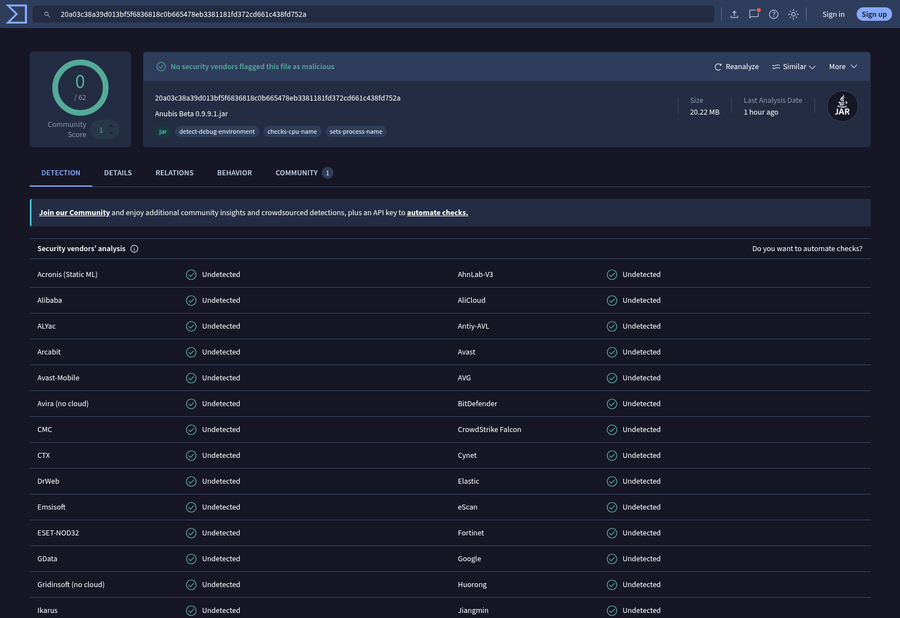
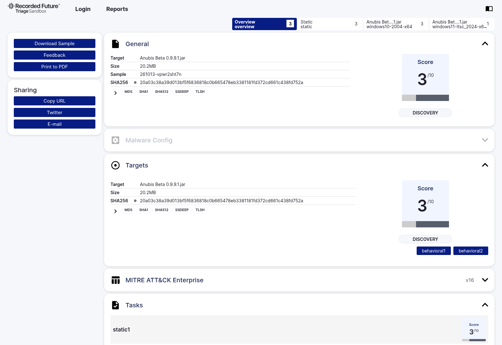
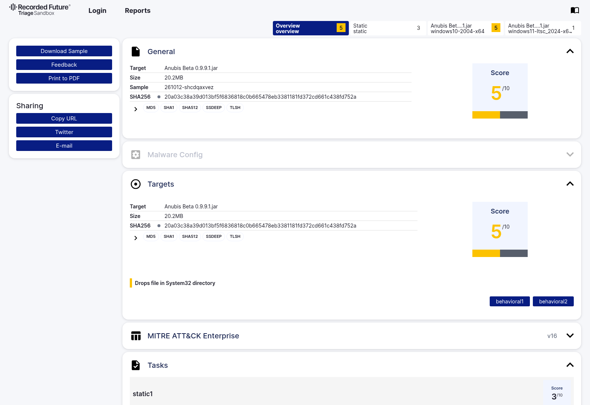
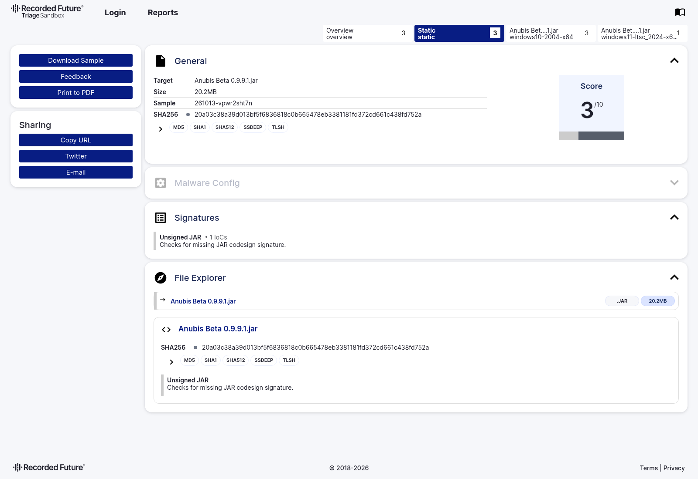
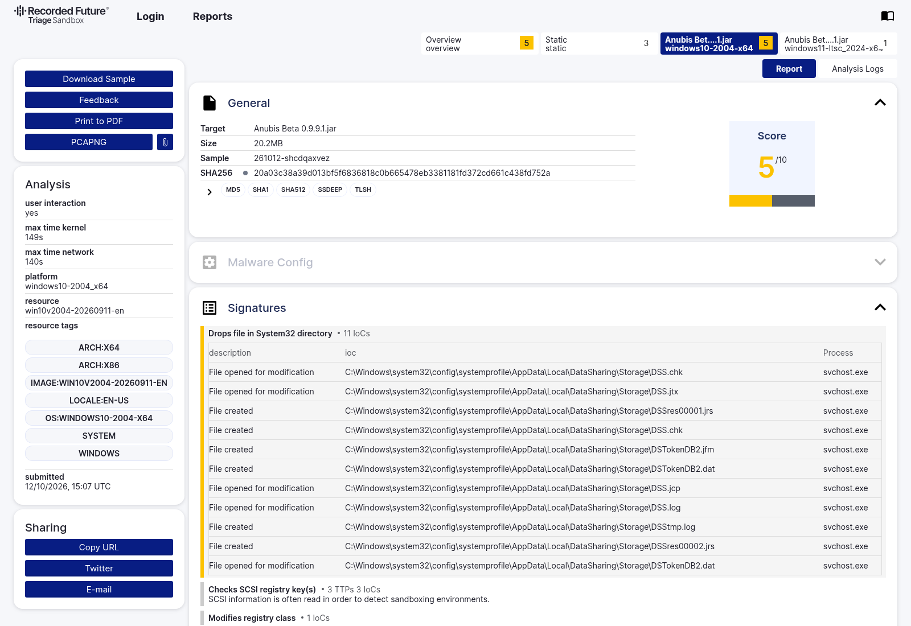
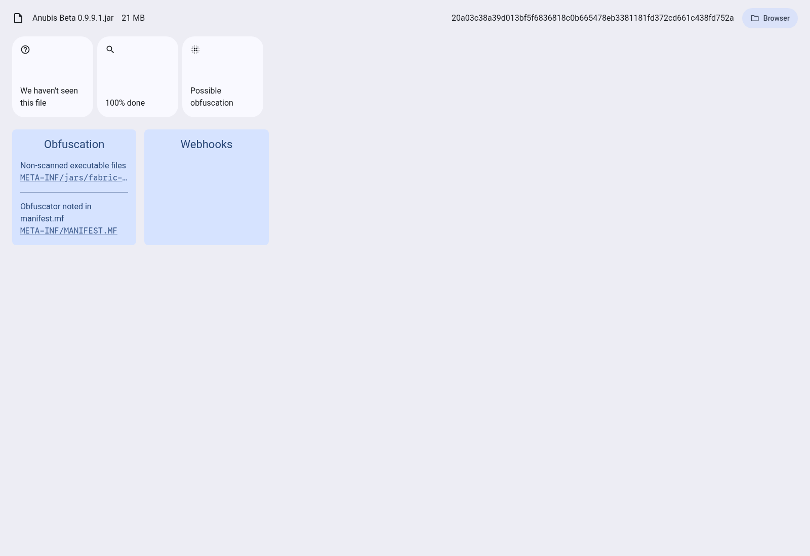
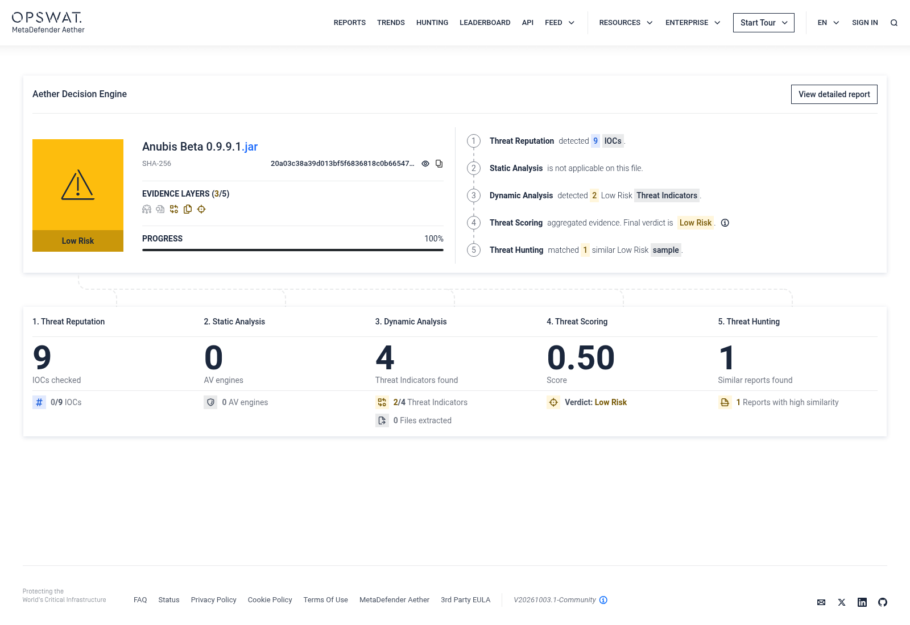
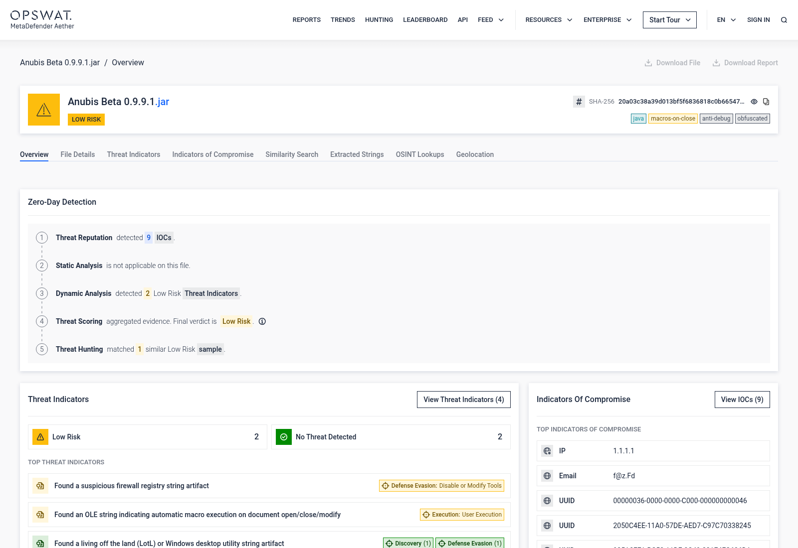
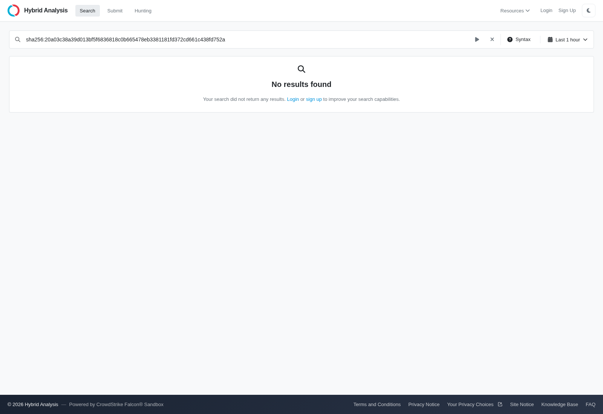

# Verified scanner results · exact Anubis JAR

**Checked on 2026-10-13.** These are actual observations, with public result links, captured screenshots and preserved data. They supplement the [static account-security review](ANUBIS-SECURITY-REPORT.md); they do not replace its code evidence.

```text
Anubis Beta 0.9.9.1.jar · 21,206,373 bytes
SHA-256: 20a03c38a39d013bf5f6836818c0b665478eb3381181fd372cd661c438fd752a
```

## Results at a glance

| Scanner | Verified observation | Result / evidence |
|---|---|---|
| VirusTotal | **0/62 detections** displayed; 62 undetected, 2 timeouts, 3 failures, 8 unsupported engines | [Public report](https://www.virustotal.com/gui/file/20a03c38a39d013bf5f6836818c0b665478eb3381181fd372cd661c438fd752a/detection) · [preserved engine results](../evidence/scanners/virustotal-report.json) |
| Recorded Future / Hatching Triage | Existing exact-hash reports include **3/10 and 5/10** scores; both are included | [3/10 report](https://tria.ge/261013-vpwr2sht7n) · [5/10 report](https://tria.ge/261012-shcdqaxvez) · [all 16 distinct links observed](../evidence/scanners/triage-report-links.json) |
| RatRater 2, local static scanner | No known-family signature or session-token flag returned; **two warnings** explained below; no fixed Discord webhook found | [Scanner](https://kendell.dev/RatRater2/) · [local result JSON](../evidence/scanners/ratrater2-local.json) |
| RatRater 2, remote Quantiy classifier | Authorized submission returned HTTP 200, **`{"class":"no"}`** | [Response](../evidence/scanners/ratrater2-cloud.json) · [submission provenance](../evidence/scanners/ratrater2-cloud-provenance.json) |
| Filescan.io / MetaDefender Aether | Fresh scan **finished: Low Risk**; API verdict `SUSPICIOUS`, threatLevel 0.5; two suspicious string heuristics explained below | [Detailed result](https://www.filescan.io/uploads/6acea7db6d047129e7cd2b7a/reports/90607aed-5383-4428-b4c2-f19b54f15c51/overview) · [preserved API result](../evidence/scanners/filescan-api.json) |
| Hybrid Analysis | Exact-hash query returned **“No results found”** with a **Last 1 hour** filter and anonymous-search limitations | [Search](https://hybrid-analysis.com/search?q=sha256%3A20a03c38a39d013bf5f6836818c0b665478eb3381181fd372cd661c438fd752a) · [captured search text](../evidence/scanners/hybrid-analysis-search.txt) |
| OPSWAT MetaDefender Cloud API | Hash lookup returned **HTTP 401 Unauthorized** without an API key; no multi-engine result obtained from this API | [Hash lookup endpoint](https://api.metadefender.com/v4/hash/20a03c38a39d013bf5f6836818c0b665478eb3381181fd372cd661c438fd752a) |

**0/62 is an observed detection ratio, not a safety probability.** An empty or inaccessible search result is not an antivirus verdict. Scores belong to their respective services and are not directly comparable to each other or to this report's account-safety meter.

## VirusTotal · real public result



The public report matched both **SHA-256 and byte size**. The recorded last-analysis time was **2026-10-13 20:01:45 UTC**. The screenshot and selected public-report JSON were captured through the normal public website; no account API key was extracted or substituted.

The underlying list contains 75 engine entries: **62 undetected, 0 malicious, 0 suspicious, 2 timeout, 3 failure and 8 type-unsupported**. The displayed denominator is 62; the remaining engines did not provide usable negative verdicts. See the [engine-by-engine JSON](../evidence/scanners/virustotal-report.json).

The website also displayed tags including `detect-debug-environment`, `checks-cpu-name` and `sets-process-name`. These are behavioral/capability tags, **not antivirus detections**. A tag without a process, caller and credential destination does not establish account stealing. Their presence is retained rather than relabeled as a clean behavior report.

This was an **existing report lookup**, not a fresh VirusTotal upload or reanalysis initiated by this review. Antivirus results can change after the capture date.

## Triage · retain the higher score and inspect attribution





The search returned **16 distinct report IDs** for this SHA-256, after deduplicating task rows. The [link inventory](../evidence/scanners/triage-report-links.json) preserves every distinct report visible in the retrieved page, its submission time and score. This is not a claim that every historical report or every task was manually investigated.

<details>
<summary>All 16 distinct exact-hash Triage report links observed</summary>

| Report | Submitted (UTC) | Overview score |
|---|---|---|
| [261013-vpwr2sht7n](https://tria.ge/261013-vpwr2sht7n) | 2026-10-13T17:10:25Z | 3/10 |
| [261013-s1exkay1cy](https://tria.ge/261013-s1exkay1cy) | 2026-10-13T15:35:14Z | 3/10 |
| [261013-r631xavy8j](https://tria.ge/261013-r631xavy8j) | 2026-10-13T14:49:12Z | 3/10 |
| [261012-zcy4vswz4p](https://tria.ge/261012-zcy4vswz4p) | 2026-10-12T20:35:01Z | 3/10 |
| [261012-ynbl9sas8r](https://tria.ge/261012-ynbl9sas8r) | 2026-10-12T19:55:27Z | 3/10 |
| [261012-ybqknahz9p](https://tria.ge/261012-ybqknahz9p) | 2026-10-12T19:36:56Z | 3/10 |
| [261012-x8f7tahz6n](https://tria.ge/261012-x8f7tahz6n) | 2026-10-12T19:31:14Z | 3/10 |
| [261012-x1ezsaztas](https://tria.ge/261012-x1ezsaztas) | 2026-10-12T19:18:56Z | 3/10 |
| [261012-shcdqaxvez](https://tria.ge/261012-shcdqaxvez) | 2026-10-12T15:07:08Z | 5/10 |
| [261012-rbygyafs7m](https://tria.ge/261012-rbygyafs7m) | 2026-10-12T14:01:46Z | 3/10 |
| [261012-q99gesdg62](https://tria.ge/261012-q99gesdg62) | 2026-10-12T13:58:49Z | 3/10 |
| [261012-ptmgaaet8r](https://tria.ge/261012-ptmgaaet8r) | 2026-10-12T12:37:20Z | 3/10 |
| [261012-ghrb4a1zcx](https://tria.ge/261012-ghrb4a1zcx) | 2026-10-12T05:48:36Z | 3/10 |
| [261012-a2y3qad18x](https://tria.ge/261012-a2y3qad18x) | 2026-10-12T00:43:08Z | 3/10 |
| [261011-zkx7jaw1bt](https://tria.ge/261011-zkx7jaw1bt) | 2026-10-11T20:47:12Z | 3/10 |
| [261011-y8h7vaex7m](https://tria.ge/261011-y8h7vaex7m) | 2026-10-11T20:27:16Z | 3/10 |

</details>

The latest displayed submission, [261013-vpwr2sht7n](https://tria.ge/261013-vpwr2sht7n), had overview/static/Windows 10 scores of 3 and a Windows 11 score of 1. The selected higher-score submission, [261012-shcdqaxvez](https://tria.ge/261012-shcdqaxvez), had overview/Windows 10 scores of 5, static 3 and Windows 11 1.

### “Unsigned JAR” · accurate signal, unsupported theft inference



The [static task](https://tria.ge/261013-vpwr2sht7n/static1) reports **“Unsigned JAR — Checks for missing JAR codesign signature.”** This is an authenticity/trust signal, not proof of a RAT. Ordinary unsigned Fabric mods can trigger it. The proper conclusion is that no signing identity was established by that check; it does not authenticate the mod, and it does not demonstrate credential collection or export.

### “Drops file in System32 directory” · displayed process is svchost.exe



The [5/10 Windows 10 task](https://tria.ge/261012-shcdqaxvez/behavioral1) lists 11 file events under `C:\Windows\system32\config\systemprofile\AppData\Local\DataSharing\Storage\`. **Every displayed process is `svchost.exe`.** Its process list identifies the Windows Data Sharing service command `svchost.exe -k LocalSystemNetworkRestricted -p -s DsSvc`.

Other alerts in that run are attributed to `taskmgr.exe`, `mspaint.exe` or `OpenWith.exe`: SCSI registry reads, process enumeration, privilege adjustments and window hooks. These are real recorded operations in the sandbox. **Calling them Anubis behavior is unsupported by the displayed attribution.** Their process names and standard paths support an environment/background-activity explanation; an exhaustive causal investigation was not performed.

The [newer 3/10 Windows 10 task](https://tria.ge/261013-vpwr2sht7n/behavioral1) similarly associates the reviewed registry/process/memory-operation alerts with `chrome.exe` processes. A browser's `WriteProcessMemory` alert is not, by itself, proof that the mod stole a session token.

The higher-score browser page also displayed certificate-revocation requests to `c.pki.goog`. These are not a demonstrated account-token collector. No inference about every possible network event is made from that short list.

### Crucial coverage limit · standalone launch is not Fabric execution

These are **pre-existing third-party runs**. Their process lists show an attempt to launch the target as a standalone JAR. The reviewed manifest has **no Main-Class**, and this artifact expects Fabric/Minecraft. The reports do not establish a correctly loaded Fabric client, triggered account login or exercised gameplay features. No standalone launch was performed in our cloud workspace.

Therefore, a low score or lack of observed token export in these sandboxes does **not** prove how the mod behaves when properly loaded. Conversely, unrelated process telemetry should not be assigned to Anubis merely because it appears on the same sample page. The static call-chain review remains the stronger evidence for account-token behavior.

## RatRater 2 · actual warnings and a narrow negative result



This is a screenshot of the **real upstream scanner running locally**, not a screenshot of a hosted public scan. Source revision: [`c8bcb930e863f76b29277d9309b50532b00558f1`](https://github.com/KTibow/RatRater2/tree/c8bcb930e863f76b29277d9309b50532b00558f1). Its pinned dependency lockfile was used. The scanner reads ZIP/class bytes as data; target code was not run.

The local scanner examined **1,110 outer class files and the manifest**, returning an empty ordinary-flags map and no known-family signature. Its optional fixed-webhook search returned an empty set. This does not negate the separate account manager or optional user-configured webhook functionality found in the full review.

| Actual warning | Why it appeared | Interpretation |
|---|---|---|
| Non-scanned executable files | The outer archive contains nested library JARs, starting with fabric-api-base | **Accurate coverage warning.** This scanner does not recursively scan those libraries or native payloads. Our separate static review inspected all 14 nested archives. |
| Obfuscator noted in manifest.mf | Its manifest regex matches any line containing `protected`, case-insensitively | **Specific false positive for this artifact.** The matched lines list ordinary class names in Fabric's client-only entry metadata. |

The exact [scanner rule](https://github.com/KTibow/RatRater2/blob/c8bcb930e863f76b29277d9309b50532b00558f1/src/lib/analysis/runAnalysis.ts) is:

```javascript
contents.match(/^(?=.*protected).*$/im)
```

Here it hits names such as `nameprotect/ProtectedText$Pieces.class` and `playerbypass/ProtectedChunkStore.class` inside **Fabric-Loom-Client-Only-Entries**. There is no obfuscator declaration in those matches. See the [original manifest](../evidence/anubis/metadata/META-INF/MANIFEST.MF) and [exact matched lines](../evidence/scanners/ratrater2-context.json). This explains this warning specifically; it does not dismiss unrelated future warnings.

The scanner's official-file list contained 662 records and no exact-hash match in the retrieved snapshot. **“We haven't seen this file” means not recognized in that list**, not malware detected or publisher authenticity verified.

**Screenshot limitation:** the initial local scan blocked the remote classifier. Its UI still says “100% done” because it counts settled tasks, including the failed remote task. The raw JSON preserves that error. Subsequently, after the user authorized public submission and remote analysis, the same original JAR was separately sent to the scanner's **Quantiy classifier** endpoint. It returned HTTP 200 with:

```json
{"class":"no"}
```

That response is preserved with [submission provenance](../evidence/scanners/ratrater2-cloud-provenance.json). It is a negative result for **that classifier**, not a guarantee against every RAT family, native payload or obfuscated stealing path. The endpoint returned no persistent per-file share URL; the preserved evidence links above are the shareable record.

## Filescan.io · authorized fresh submission



The original JAR was submitted through the normal public interface after explicit authorization for uploads and remote sandbox analysis. The [result page](https://www.filescan.io/uploads/6acea7db6d047129e7cd2b7a) and API match **the original SHA-256 and 21,206,373-byte size**. The scan started at 2026-10-13 21:51:23 UTC. The API reports `state: finished`, `allFinished: true`, `overallState: success` and no task warnings.

**Preserve the vendor's actual verdict:** the UI says **Low Risk**; the API reports `verdict: SUSPICIOUS`, `verdictLabel: low_risk`, `threatLevel: 0.5`. This is not “clean,” and 0.5 is not a 50% probability that the mod is malicious. The [original response](../evidence/scanners/filescan-api.json) retains all four signal groups, their matched text and verdicts.



[Detailed report permalink](https://www.filescan.io/uploads/6acea7db6d047129e7cd2b7a/reports/90607aed-5383-4428-b4c2-f19b54f15c51/overview). The screenshot preserves the service's tags, including `macros-on-close`, `anti-debug` and `obfuscated`; their labels do not establish account theft. The explanation below traces the actual matched evidence rather than deleting inconvenient labels.

| Actual suspicious signal | Scanner's matching evidence | Code context and assessment |
|---|---|---|
| **S023: suspicious firewall registry string artifact** | `proxyserver` in `com/example/client/mixin/MixinProxyServerStatusPinger.class` and the same ZIP filename followed by `PK` | **False inference from a class-name substring.** This mixin routes Minecraft server-list ping connections through the configured Netty SOCKS handler. The matched filename is not a Windows registry path or evidence of firewall modification. |
| **S041: OLE string indicating automatic macro execution** | `AutoClose` in a decompiled Spotify utility text fragment | **Unsupported Office-macro interpretation of Java text.** Reviewed Spotify classes use Java `AutoCloseable` for resource cleanup. LyricsService.close stops workers/HTTP executors; this is not an Office AutoClose macro or an OLE document event. The scanner's excerpt is truncated, so its exact character offset is not reconstructed. |

The proxy mixin's bytecode calls `ProxyRouting.route(target, initializer)` and the original Netty handler operation. The routing implementation selects `Socks4ProxyHandler`/`Socks5ProxyHandler` for deliberate configured proxies. Evidence: [mixin source](../evidence/anubis/sources/jadx/com/example/client/mixin/MixinProxyServerStatusPinger.java), [bytecode](../evidence/scanners/mixin-proxy-bytecode.txt), [ProxyRouting source](../evidence/anubis/sources/jadx/net/anubis/client/proxy/ProxyRouting.java).

LyricsService explicitly implements `AutoCloseable`, and its `close()` method releases Java resources. Evidence: [JADX source](../evidence/anubis/sources/jadx/net/anubis/client/util/spotify/LyricsService.java), [CFR source](../evidence/anubis/sources/cfr/net/anubis/client/util/spotify/LyricsService.java), [existing bytecode cross-check](../evidence/anubis/javap/net.anubis.client.util.spotify.LyricsService.txt). The service's matched origin is `JAVA_DECOMPILATION`, strengthening the Java-text explanation rather than an Office-file interpretation.

The other two groups are **already rated NO_THREAT by the service**: desktop-utility word matches (`label`, `ping`, `relog`, `reset`, `shadow`) and a reflective `getMethod` reference. These are not additional positive malware verdicts.

**Coverage limit:** the dashboard says “Static Analysis is not applicable on this file,” shows **0 AV engines**, and labels string-derived findings under “Dynamic Analysis.” The detailed page explicitly says **“Emulation Data is not applicable for this file”** and supplies no emulated process/network data. The preserved signals originate from `INPUT_FILE`/`JAVA_DECOMPILATION`; they do not demonstrate that Fabric/Minecraft ran or that account/login paths were exercised. The dashboard's 100% means its job finished, not that every advertised analysis layer applied. This is a separate Aether assessment, not a substitute for MetaDefender Cloud's unavailable multi-engine API result.

The detailed page's file-magic label mentions an Android package because the archive includes a DEX; the independently inspected Fabric metadata and loader behavior identify this artifact as a Minecraft mod with an embedded Android picker. That magic label does not establish an Android malware payload. Its indicator list includes `1.1.1.1` (the reviewed SOCKS connectivity target) and Windows COM interface identifiers. These are investigation strings, not demonstrated account-token collectors; a string listed as an IOC is not automatically an actual compromise.

## Other services · unavailable is not clean



Hybrid Analysis returned “No results found,” but the public UI retained a **Last 1 hour** filter and offered more capabilities to signed-in users, including when the URL's explicit time-filter parameter was removed. We cannot claim there are no older/private reports. Its link is a **search**, not a verified clean result. No new Hybrid Analysis submission was completed.

MetaDefender Cloud's official hash API returned HTTP 401 without credentials. A portal landing page, API authentication failure or site-access failure does not supply a scan verdict. No successful result from that API is claimed.

No standalone ClamAV/YARA antivirus verdict or full runtime RAT certification was produced. The actual completed tools/results are named above; static keyword searches in our full report are not relabeled as extra antivirus engines.

## What these checks mean for account security

The retrieved antivirus result and narrow RAT classifier are consistent with the static review's **“no account/session-token stealing path identified”** conclusion. They do not erase its confirmed weakness: **saved refresh/session tokens are written in plaintext**.

Tokens also reach official Microsoft/Xbox/Minecraft services during deliberate login, as the [account flow review](ACCOUNT-TOKEN-REVIEW.md) documents. No reviewed route sends them to an unrelated collector. Protect the account file and its backups; a zero-detection result does not protect a plaintext secret from someone who can read it.

**Assessment remains: Credential-storage caution, with bounded confidence.** No unsupported “100% safe,” fake safe percentage, fabricated vendor result or blanket whitelist recommendation is implied.
